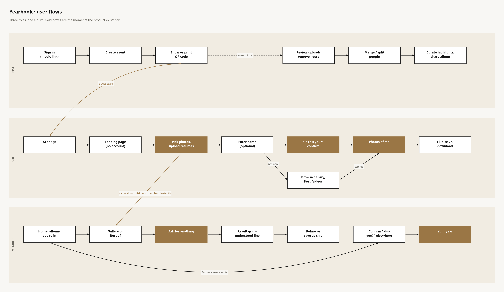
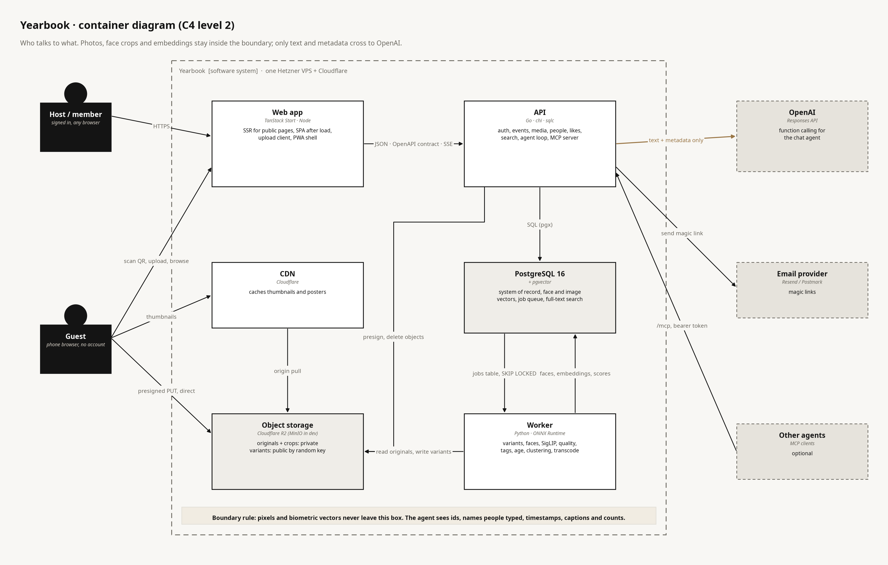
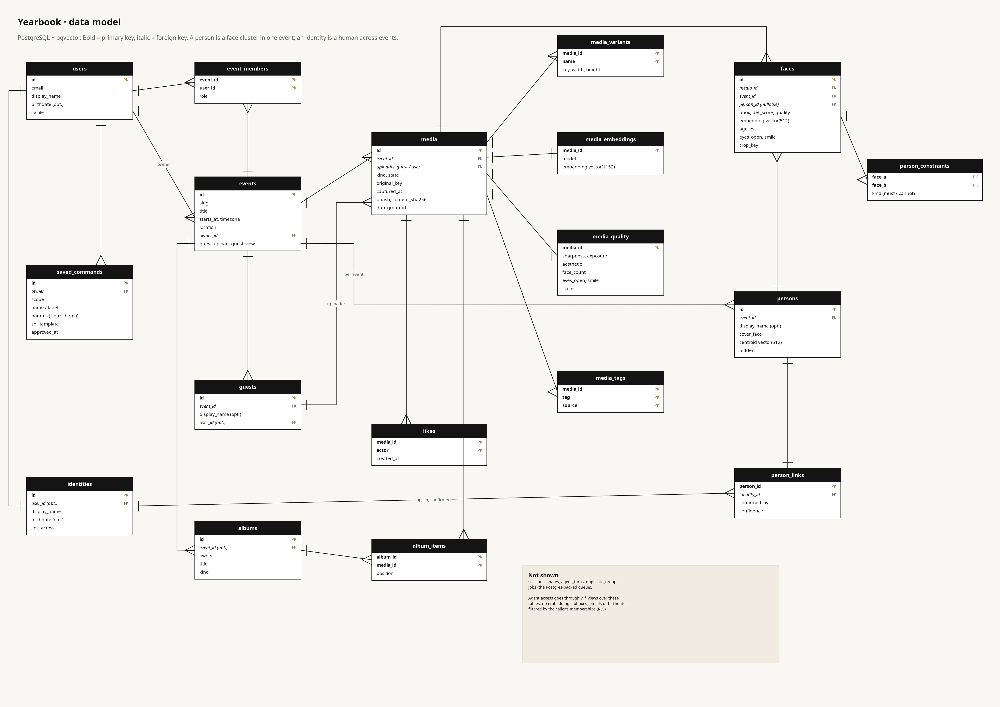
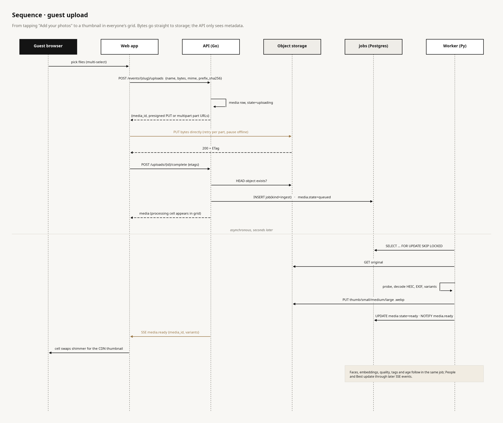
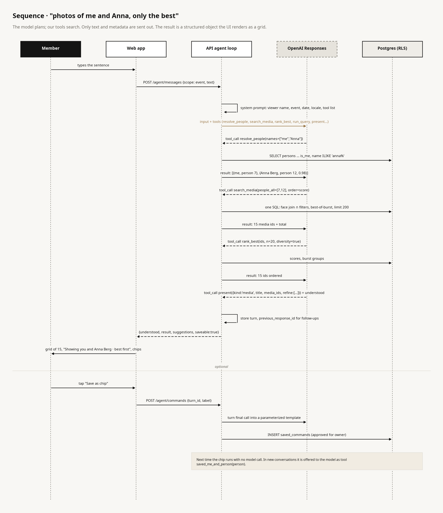
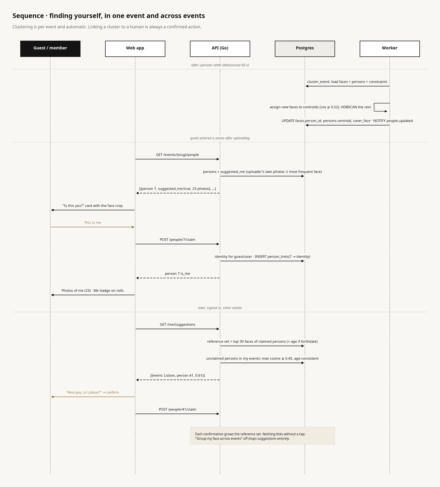
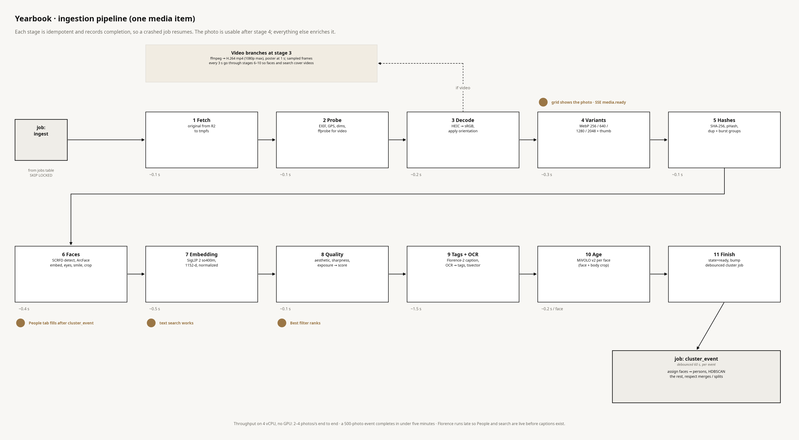

# Yearbook — Software Design Document

Status: draft v0.1 for review, 2026-10-09. No code exists yet. Diagrams are generated by `docs/diagrams/build.py` (`uv run docs/diagrams/build.py`); edit the script, not the images.

Visual design: the "Yearbook core screens" canvas in Claude Design, rows **Final** and **Final · host and account screens**. Token values there in `final.css` are authoritative over the design system's older `tokens.json` until that file is updated.

---

## 1. Purpose

Yearbook is a shared photo album that assembles itself. A host creates an event, a QR code goes on the table, guests tap it and upload photos and videos from their phone browser with no app and no account. Afterwards everyone can find the photos they are in, see the best shots, like them, and ask for anything in plain language. Events accumulate into a personal yearbook: people, years and moments across every event you were part of.

Target: a multi-tenant product for many families. The first builds run on one EU VPS and are piloted with a few families the operator knows; decisions that must change before opening sign-ups are marked **(public)** and collected in milestone M7.

## 2. Requirements

### 2.1 Must have (v1)

| # | Requirement | Acceptance |
|---|---|---|
| R1 | Guest upload without account from a QR or link | QR scan to first uploaded photo in two taps; works on iOS Safari and Android Chrome on venue WiFi; interrupted uploads resume |
| R2 | Photos and videos in one album | JPEG, PNG, HEIC, WebP, AVIF, MP4, MOV accepted; HEIC displays everywhere; videos play with a poster frame |
| R3 | Fast, dense gallery | Thumbnails from a CDN; grid grouped by time of day; a new photo is visible to everyone within seconds of upload |
| R4 | Faces grouped into people, per event | Each event has a People tab; a guest who entered a name sees an "Is this you?" card; "This is me" gives "Photos of me" |
| R5 | Correction tools | Name, merge, split and "not a person" are available; corrections survive reclustering |
| R6 | Cross-event identity, opt-in | Signed-in users get "also you?" suggestions in other events; nothing links without confirmation |
| R7 | Text search over photo content | "the cake", "Gruppenfoto", "balcony" return relevant photos; German and English |
| R8 | Quality ranking | Best filter and Highlights page rank by sharpness, aesthetics, faces, eyes open, smile, likes; bursts collapse to one |
| R9 | Age-aware queries | With an optional birthdate, "me between 10 and 15" works exactly; without one, an estimate is used and labeled as such |
| R10 | Likes | Any participant can like; counts feed ranking |
| R11 | Chat agent | A sentence in the "Ask for anything" input returns a visual result with a one-line "understood" summary; successful requests can be saved as chips |
| R12 | Agent long tail | Questions like "who did I spend the most time with this year" are answered without a pre-built feature |
| R13 | Download and share | Single photo, selection as zip, and a read-only link to a curated set |
| R14 | Privacy controls | Hide me, delete my face data, download my data, delete account; per-event guest permissions for hosts |
| R15 | Biometrics stay home | Face crops, face and image embeddings never leave the operator's infrastructure |

### 2.2 Nice to have (v2 candidates)

Comments and notifications · native mobile app with background camera-roll upload · video transcripts and scene search · rich captions from a vision-language model · agent sandbox for collages and charts · live slideshow at the venue · printable yearbook PDF · Passkeys · dark theme · public hosting with signed CDN access.

### 2.3 Non-functional

| Area | Target |
|---|---|
| Scale | 200 events, 100k photos, 50 concurrent uploaders at one party, on a 4 vCPU / 16 GB VPS |
| Ingest latency | thumbnail visible < 10 s after upload; faces and search < 5 min for a 500-photo event |
| Page weight | landing < 100 KB JS, gallery < 250 KB JS gzipped; Lighthouse mobile ≥ 90 |
| Availability | single node, nightly backups, restore drill monthly; no HA in v1 |
| Localization | German and English, strings survive +30% length at 320 px |
| Accessibility | real controls, visible focus, 44 px targets, 4.5:1 text contrast |
| Privacy | GDPR-aligned data map, deletion paths tested end to end, EU hosting |

### 2.4 Out of scope for v1

Comments, photo editing, public discovery of events, multi-tenant billing, native apps.

## 3. Users and flows



**Host**: sign in with a magic link, create an event, show or print the QR. After the event: review uploads, remove or retry items, merge or split people, curate highlights, share.

**Guest**: scan, land on the event page, pick photos, watch them upload (resumable), optionally enter a name, confirm "Is this you?", get "Photos of me", like and download. A guest never needs an account; a cookie scoped to the event remembers them.

**Member** (signed in): home shows the albums they appear in with "N of you"; gallery, Best, and the agent input; People across events with confirmed suggestions; Your year as the recap surface.

## 4. Architecture



| Container | Technology | Responsibility |
|---|---|---|
| Web app | TanStack Start (React 19, TanStack Router + Query, Vite), Node | SSR for public routes so links unfurl in WhatsApp; SPA behaviour after hydration; upload client; PWA shell. Thin: business logic lives in the API |
| API | Go 1.23+, chi, sqlc, pgx, goose; OpenAPI contract with `oapi-codegen` server stubs | Auth, events, media metadata, presigned uploads, people, likes, hybrid search, agent loop, MCP server, SSE |
| Worker | Python 3.12, uv, ONNX Runtime, PyTorch where needed, ffmpeg | Everything that touches pixels: variants, HEIC, EXIF, hashes, faces, SigLIP, quality, tags, age, clustering, transcode |
| PostgreSQL 16 + pgvector | | System of record, face and image vectors (HNSW), full-text search, job queue |
| Object storage | Cloudflare R2 or Hetzner Object Storage (SeaweedFS in dev) | Originals and face crops in a private bucket; variants in a public bucket under random keys |
| CDN | Cloudflare | Caches variants; zero egress from R2 |
| OpenAI | Responses API with function calling | Language layer of the agent; receives text and metadata only |
| Email | Resend or Postmark | Magic links |

Repository layout (monorepo): `apps/web`, `apps/api`, `apps/worker`, `packages/openapi` (the contract; the web client is generated from it with `openapi-typescript` + `openapi-fetch`), `infra` (Compose, Caddy, migrations), `docs`.

Deployment: Docker Compose on one Hetzner VPS with Caddy for TLS during the pilot. All services are stateless containers configured by environment, so the move to Kubernetes with an Ingress (M7) is packaging, not a rewrite.

### 4.1 Key decisions

| Decision | Why | Trade-off |
|---|---|---|
| Go API, Python workers, TypeScript web | Each language where it is strongest; Go is a learning goal on the part where it shines | Three languages, one contract to maintain |
| TanStack Start, not Next.js | SSR where needed, Vite, type-safe routing, no vendor coupling; Next's image optimizer is irrelevant with precomputed variants | Younger ecosystem; pin versions |
| Precomputed WebP variants on a CDN | Encode once, cache forever, predictable cost | ~15% extra storage |
| Unguessable keys, not signed URLs, for variants | Simple clients, full CDN cacheability | Anyone with a URL can view that variant **(public: switch to signed cookies)** |
| Postgres as the job queue | One fewer service, transactional enqueue | Revisit above ~50 jobs/s |
| pgvector for faces and images | Vectors next to rows, one SQL for hybrid queries, RLS applies | HNSW build time at tens of millions of rows |
| Per-event clustering, opt-in cross-event identity | Privacy and accuracy; recognition across years is unreliable | One confirmation per event per person |
| Agent = fixed tools + scoped SQL + saved commands | Long tail without arbitrary code execution; safety is structural | Pixel-level tasks wait for a sandbox (v2) |
| OpenAI for language, all perception local | Operator preference; biometrics never leave | External dependency on the agent path only; `/search?q=` works without it |
| Birthdate first, MiVOLO second for age | Arithmetic is exact; the model covers undated scans and cross-age linking | Estimates ±4 years, never shown as fact |

### 4.2 Storage and import

**Where bytes live.** Originals in a private S3 bucket, variants in a public bucket behind the CDN. Production: Cloudflare R2 or Hetzner Object Storage (same S3 API; Hetzner keeps the whole data map in Germany). Dev: SeaweedFS (MinIO stopped free images in 2025). Rough cost: 100k photos ≈ 400 GB ≈ 6 EUR/month; video dominates after that. All code is S3-generic: endpoint, path style and `checksum = when_required` are config.

**Yearbook is the destination, not an aggregator.** Google removed the Photos Library API read scopes on 2025-03-31; apps can read only what they uploaded, plus whatever the user picks in the Picker API. Apple has no public iCloud Photos API. So "one place for everything" means importing copies through a few well-built doors:

| Door | What | When |
|---|---|---|
| Takeout import | Upload or point at a Google Takeout archive; worker walks it, reads the JSON sidecars (capture time, location, people names you tagged) and seeds person labels | M1.5 |
| Folder / zip import | Same pipeline for Apple Photos "Export Unmodified Originals", a NAS folder, an old disk; CLI on the server and bulk drag-and-drop in the web app | M1.5 |
| Google Photos Picker | OAuth, user picks items in Google's UI, we fetch those | M5 |
| Share target + Shortcut | PWA share target so Photos → Share → Yearbook works; iOS Shortcut posting to a personal token endpoint | M5 |
| Camera-roll background sync | Expo app with PhotoKit / MediaStore | v2 |
| icloudpd | Operator-run sync of the operator's own iCloud account; not a product feature | optional |

**Library and events.** Imported photos need a home that is not an event. `media.owner_id` identifies the owning user and `media.event_id` is nullable: a user has a personal library, events are where photos are shared. Imports auto-match to the owner's events by capture time (and location when present) and are otherwise filed in the library, where Your year and the agent still see them. Dedupe by SHA-256 and pHash makes re-import safe.

## 5. Data model



Two identity concepts, kept apart on purpose. A **person** is a face cluster inside one event and exists whether or not anyone named it. An **identity** is a human across events, either a user or a named non-user; `person_links` ties persons to identities and every row is a confirmed action.

Other rules of the model:

- `media.owner_id` is the importing or uploading user when known; `event_id` is nullable so a personal library exists next to events.
- All public ids are 128-bit random values. Event slugs are readable with a random suffix and act as capabilities.
- `media` carries capture time with its source (EXIF, filename, upload) so grouping can say how confident it is. GPS is reduced to a coarse place name.
- Derived data lives in satellite tables keyed by `media_id`, so a re-run of one stage replaces one table.
- Manual corrections are `person_constraints` (must-link, cannot-link) that the clusterer must satisfy.
- The agent reads through `v_*` views as a read-only role: no embeddings, boxes, emails or birthdates; rows filtered by the caller's memberships via `SET LOCAL app.actor`.
- Deletion cascades downward and schedules object deletion. A deleted photo leaves a 30-day tombstone so CDN caches expire.

The DDL for the core tables is in Appendix A.

## 6. Interfaces

Base path `/api/v1`, JSON, cursor pagination, stable error codes. Three principals: **user** (session cookie from a magic link), **guest** (per-event cookie), **share** (read-only link). Full detail belongs in `packages/openapi/openapi.yaml`; the surface is:

| Group | Endpoints |
|---|---|
| Auth and account | `POST /auth/magic`, `POST /auth/verify` (the emailed link opens a web page that posts the token, so mail scanners cannot consume it), `POST /auth/logout`, `GET/PATCH /me`, `DELETE /me/face-data`, `DELETE /me` |
| Events | `POST/GET /events`, `GET/PATCH/DELETE /events/{slug}`, `GET /events/{slug}/qr.svg`, `GET /events/{slug}/print.pdf`, `GET /events/{slug}/status`, `GET /events/{slug}/events` (SSE) |
| Uploads | `POST /events/{slug}/uploads` → presigned single or multipart URLs; `POST /uploads/{id}/complete`; `DELETE /uploads/{id}` |
| Media | `GET /events/{slug}/media?filter=all\|best\|videos\|mine\|person:{id}\|album:{id}`, `GET/DELETE /media/{id}`, `GET /media/{id}/original`, `POST /media/zip`, `PUT/DELETE /media/{id}/like` |
| People | `GET /events/{slug}/people`, `GET/PATCH /people/{id}`, `POST/DELETE /people/{id}/claim`, `POST /people/merge`, `POST /people/{id}/split`, `POST /faces/{id}/not-person`, `GET /faces/{id}/crop.jpg`, `GET /me/people`, `GET /me/suggestions` |
| Albums and shares | `GET /events/{slug}/albums`, `POST/PATCH /albums`, `POST /albums/{id}/share`, `GET /s/{share_id}` |
| Search and agent | `GET /events/{slug}/search?q=` (no LLM), `POST /agent/messages`, `GET/POST/DELETE /agent/commands` |
| Host | `GET /events/{slug}/uploads`, `POST /media/{id}/retry` |
| MCP | `/mcp`, streamable HTTP, bearer token bound to a user session |

The grid item shape is deliberately small: id, kind, state, capture time, dimensions, four variant URLs, poster, like count and liked flag, "me" flag, person ids, score, processing flag.

## 7. Key sequences

### 7.1 Guest upload



Bytes never pass through the API. The browser asks for an upload intent, PUTs directly to storage with per-part retry and offline pause, then calls complete. The API verifies the object, enqueues an `ingest` job, and the grid shows a processing cell at once. Variants arrive seconds later through SSE.

Client details: concurrency 3, single PUT under 64 MB, S3 multipart with 8 MB parts above, jittered backoff, an IndexedDB manifest so a reload offers "Resume 4 uploads", local previews via `createImageBitmap`, no client-side transcoding.

### 7.2 The agent answering a sentence



The model plans, our tools search. The loop runs in Go, capped at 6 tool rounds and 20 seconds. The model must end by calling `present`, whose argument is the structured result the UI renders. Follow-ups reuse `previous_response_id` for 30 minutes.

### 7.3 Finding yourself



Clustering is automatic and per event. The "Is this you?" suggestion comes from a cheap heuristic: the most frequent face in the uploader's own photos. Cross-event suggestions compare unclaimed persons against a reference set built from the user's confirmed faces, with an age-consistency check when a birthdate is known. Nothing links without a tap.

## 8. Ingestion pipeline



Workers are stateless Python processes polling the `jobs` table with `SELECT … FOR UPDATE SKIP LOCKED`, heartbeating every 30 s, with exponential backoff and a per-job attempt cap. Each stage records completion in `media.processed_stages`, so a crash resumes rather than restarts.

### 8.1 Models

| Purpose | Model | Notes |
|---|---|---|
| Face detect + embed | InsightFace `antelopev2` (SCRFD-10GF + ArcFace R100) | ONNX, CPU or CUDA. Model pack is non-commercial: fine self-hosted **(public: AdaFace)** |
| Eyes open, smile | InsightFace landmarks | Geometry heuristics, used for ranking only |
| Image embedding + text search | SigLIP 2 `so400m-patch14-384`, 1152-d | Multilingual; the text tower also runs inside the Go API via ONNX so a query never round-trips to a worker |
| Aesthetic | aesthetic-predictor-v2.5 | Linear head on SigLIP features, essentially free |
| Tags and OCR | Florence-2 large | Caption → tags and tsvector; OCR words → tags. The slow stage, runs late |
| Age | MiVOLO v2 (face + body) | Per face; ±4 years; weight license to verify **(public)** |
| Video | ffmpeg, PySceneDetect later | H.264 1080p max, poster at 1 s, sampled frames every 3 s |

Composite quality score: `0.35·aesthetic + 0.25·sharpness + 0.15·faces_term + 0.15·eyes_smile + 0.10·likes`, weights in config, tuned on real events.

### 8.2 Clustering

Incremental on every run: a new face joins the nearest person if cosine ≥ 0.52 with a margin ≥ 0.05 to the runner-up; the remainder is clustered with HDBSCAN (`min_cluster_size` 2, cosine). A full recluster runs when an event gained more than 25% new faces or nightly; cluster ids are matched to existing persons by overlap so ids survive, then `person_constraints` are applied. Low-quality faces (quality < 0.4) are assigned only at ≥ 0.6 and stay out of the People grid. Thresholds are starting points; a `worker eval-cluster` command reports purity and completeness against a hand-labeled fixture event.

Cross-event: reference set = up to 30 best faces per claimed person; candidate threshold 0.45; when a birthdate is known and the age gap exceeds 8 years, MiVOLO's estimate must be within 6 years of the arithmetic age. Age queries use `captured_at − birthdate` for linked persons and `faces.age_est` otherwise, exposed as `age_mode: exact | estimated`.

## 9. Agent

Layered so safety is structural rather than prompt-based.

**Layer 1, fixed tools**, exposed both to the internal loop and through the MCP server: `resolve_people`, `search_media` (people all/any/exclude, free text, time and day part, kind, uploader, face counts, liked, score, age range and mode, tags, order, limit), `rank_best`, `list_people`, `describe_media`, `create_album`, `like_media`, `share_album`, `export_zip`, `event_stats`, `run_query`, `present`. Free text in `search_media` is hybrid retrieval in one SQL statement: SigLIP text embedding against the HNSW index fused with full-text and trigram matches by reciprocal rank.

**Layer 2, scoped SQL**. `run_query` executes a single `SELECT` against the `v_*` views as role `agent_ro` inside `BEGIN READ ONLY` with `statement_timeout = 2 s`, parsed with `pg_query_go` against a function allowlist, capped at 500 rows. Errors return to the model verbatim for up to two retries. This answers "who did I spend the most time with", "which event had the most photos of me", "photos where I'm the only person".

**Layer 3, saved commands**. "Save as chip" asks the model to turn the turn's final call into a template with a name, label, description, JSON-schema parameters and bind variables. Approved commands are appended to the tool list as `saved_<name>` in later conversations and shown as chips that run with no model call.

Result contract rendered by the UI:

```
media   {title, media_ids[], group_by?, refine: Chip[]}
people  {title, person_ids[]}
stat    {title, value, detail?, media_ids?}
album   {album_id, title}
clarify {question, options[]}
empty   {title, suggestions: Chip[]}
```
plus a separate one-line `understood`.

What leaves the server: the user's text, locale, scope, tool results (ids, counts, names people typed, timestamps, tags, captions, scores), the viewer's first name. Never: pixels, crops, embeddings, birthdate values, emails, GPS. One exception, user-initiated: "describe this photo" sends that single image to the vision model.

Evaluation: 60 German and English utterances with expected tool calls and result sets against the fixture event; target 90% exact result match, median latency under 4 s.

## 10. Frontend


Routes, TanStack file style:

| Area | Routes |
|---|---|
| Public (SSR, OG tags) | `/e/$slug`, `/e/$slug/upload`, `/e/$slug/photos`, `/e/$slug/photos/$photoId` (lightbox as modal route), `/e/$slug/people`, `/e/$slug/people/$personId`, `/e/$slug/best`, `/e/$slug/search`, `/e/$slug/me`, `/s/$shareId` |
| Member | `/`, `/year/$year`, `/people`, `/people/$personId`, `/search`, `/search/saved`, `/liked` |
| Host | `/new`, `/e/$slug/settings`, `/e/$slug/share`, `/e/$slug/uploads`, `/e/$slug/people/manage` |
| Account | `/login`, `/auth/verify`, `/settings`, `/activity`, `/404`, `/expired` |

Design tokens come from the Final direction: surface `#f8f7f4`, ink `#141414`, muted `#6a675f`, primary `#141414`, **you** `#9a7645` (gold, reserved for anything about the viewer), like `#b9524c`, border `#e3e0d9`; Bodoni Moda display with italics for the personal lines, Instrument Sans body, both self-hosted via Fontsource (no Google Fonts requests); square corners except face chips and the Me pill; 4 px spacing scale, 2 px grid gap, 44 px targets, 64 px bottom bar; motion 120 / 200 / 320 ms, zero under reduced motion. CSS Modules plus token variables; no Tailwind, no runtime CSS-in-JS.

Components, one folder each: PhotoCell, PhotoGrid (virtualized, 3 columns on phones), Lightbox, FaceChip, FilterChipRow, SearchInput, UploadList/UploadItem, BottomBar, Sheet, EventCard and AlbumFan, QRCard, EmptyState (no photos, no faces yet, still analyzing).

Live updates: one `EventSource` per event layout patches the Query cache on `media.ready` and invalidates on `people.updated`; falls back to a 10 s poll.

## 11. Privacy and security

Face embeddings are biometric data under GDPR Article 9. The v1 position for a closed circle: guests are told at upload that faces are grouped so people can find themselves (the fixed one-liner from the design system, in both languages), uploading is the consent action, and naming or claiming is an explicit opt-in. Hosts can hide or delete any person; anyone in the event can flag a cluster; names are visible only inside the event; there is no public discovery. **(public)**: explicit consent checkbox, per-event face-grouping toggle, DPIA, data processing terms with OpenAI.

Controls in the product: group my face across events (toggle), hide me from People, delete my face data, download my data, delete account; per event, hosts can disable guest upload or view, regenerate the link, remove anything, delete the event.

Operations: EU hosting (Hetzner Falkenstein, R2 EU jurisdiction), TLS, HttpOnly SameSite cookies, Origin checks on cookie-authenticated mutations, rate limits per guest cookie and IP, access logs on original downloads and crop views, nightly encrypted dumps with 14-day retention and a `deletion_log` replayed on restore, OpenAI zero-data-retention where the account qualifies.

## 12. Delivery plan

| Milestone | Weeks | Exit criterion |
|---|---|---|
| M0 Skeleton | 1 | Compose up serves a seeded landing page; OpenAPI stubs and TS client generate; CI green |
| M1 Upload and gallery | 2–3 | Used at one real gathering: five phones, one album, resumable uploads, likes, zip, SSE |
| M1.5 Import | 4 | Takeout archive and plain folder import with sidecar metadata, dedupe, auto-match to events; library view |
| M2 Faces and people | 5–6 | "Photos of me" works for everyone at the test event with < 10% misassignments |
| M3 Search and quality | 7 | "the cake" and "Gruppenfoto" return sensible results; Best filter and Highlights live |
| M4 Agent | 8–9 | Every sentence in §2 produces a visual result; saved chips; MCP endpoint; eval ≥ 90% |
| M5 Yearbook and age | 10 | Home with "N of you", Your year, cross-event confirmations, birthdate and age filters, privacy controls complete |
| M6 Harden and pilot | 11 | Production on Hetzner, backups and restore drill, Playwright on iOS and Android, German copy at 320 px; pilot with a handful of families |
| M7 Public launch | after pilot | Signed CDN access for variants; licensed face model (AdaFace or commercial) replacing the InsightFace pack; explicit consent step, per-event face-grouping toggle, DPIA, DPA with OpenAI, Terms and Privacy; storage quotas, rate limits, report and block, malware scanning of originals; Kubernetes with Ingress and cert-manager, NOTIFY-backed SSE for multiple API replicas; monitoring and backups with restore tests; billing and a legal entity as controller |

## 13. Open questions

1. Clustering thresholds and the quality score weights need a labeled fixture set before they mean anything. Who labels the first event?
2. Guest deletion window: 7 days from the same browser, then host-only. Too strict, too loose?
3. Should hosts be able to approve a saved command for all guests of an event, or is that a v2 feature?
4. The SigLIP text tower inside the Go API (ONNX, ~400 MB) versus a tiny Python sidecar: the former avoids a hop, the latter keeps all ML in one language.
5. Minimum face size for detection (32 px) decides whether crowd shots produce dozens of useless clusters. Needs real data.

---

## Appendix A — core DDL

```sql
create extension if not exists vector;  create extension if not exists pg_trgm;

create table users (id bytea primary key, email citext unique not null, display_name text not null,
  birthdate date, locale text not null default 'de', created_at timestamptz not null default now());

create table events (id bytea primary key, slug text unique not null, title text not null,
  starts_at timestamptz not null, ends_at timestamptz, timezone text not null default 'Europe/Berlin',
  location text, cover_media bytea, owner_id bytea not null references users,
  guest_upload boolean not null default true, guest_view boolean not null default true,
  archived_at timestamptz, created_at timestamptz not null default now());

create table event_members (event_id bytea references events on delete cascade,
  user_id bytea references users on delete cascade,
  role text not null check (role in ('owner','host','member')), primary key (event_id, user_id));

create table guests (id bytea primary key, event_id bytea not null references events on delete cascade,
  display_name text, user_id bytea references users, created_at timestamptz not null default now());

create type media_state as enum ('uploading','queued','processing','ready','failed','removed');
create table media (id bytea primary key, event_id bytea references events on delete cascade,  -- null = personal library
  owner_id bytea references users, uploader_guest bytea references guests, uploader_user bytea references users,
  source text not null default 'upload' check (source in ('upload','takeout','folder','picker','share')),
  kind text not null check (kind in ('photo','video')), state media_state not null default 'uploading',
  original_key text not null, original_mime text not null, original_bytes bigint,
  width int, height int, duration_ms int,
  captured_at timestamptz, captured_src text check (captured_src in ('exif','filename','upload')),
  gps point, place_name text, phash bit(64), content_sha256 bytea,
  dup_group_id bytea, is_best_of_dup boolean not null default true,
  processed_stages jsonb not null default '{}', processed_at timestamptz, error text,
  caption text, caption_tsv tsvector generated always as (to_tsvector('simple', coalesce(caption,''))) stored,
  created_at timestamptz not null default now());
create index on media (event_id, captured_at);  create index on media (event_id, state);

create table media_variants (media_id bytea references media on delete cascade, name text not null,
  key text not null, width int not null, height int not null, bytes int not null, primary key (media_id, name));
create table media_embeddings (media_id bytea primary key references media on delete cascade,
  model text not null, embedding vector(1152) not null);
create index on media_embeddings using hnsw (embedding vector_cosine_ops);
create table media_quality (media_id bytea primary key references media on delete cascade,
  sharpness real, exposure real, aesthetic real, face_count int, eyes_open real, smile real, score real);
create table media_tags (media_id bytea references media on delete cascade, tag text not null,
  source text not null, primary key (media_id, tag, source));
create index on media_tags using gin (tag gin_trgm_ops);

create table persons (id bytea primary key, event_id bytea not null references events on delete cascade,
  display_name text, cover_face bytea, face_count int not null default 0, centroid vector(512),
  hidden boolean not null default false, created_at timestamptz not null default now());
create table faces (id bytea primary key, media_id bytea not null references media on delete cascade,
  event_id bytea not null references events on delete cascade, person_id bytea references persons,
  bbox int[4] not null, landmarks real[10], det_score real not null, quality real,
  embedding vector(512) not null, age_est real, eyes_open real, smile real, crop_key text,
  created_at timestamptz not null default now());
create index on faces (event_id, person_id);  create index on faces using hnsw (embedding vector_cosine_ops);
create table person_constraints (event_id bytea not null references events on delete cascade,
  face_a bytea not null references faces on delete cascade, face_b bytea not null references faces on delete cascade,
  kind text not null check (kind in ('must_link','cannot_link')), created_by bytea, primary key (face_a, face_b));

create table identities (id bytea primary key, user_id bytea unique references users, display_name text not null,
  birthdate date, link_across boolean not null default true, created_at timestamptz not null default now());
create table person_links (person_id bytea primary key references persons on delete cascade,
  identity_id bytea not null references identities on delete cascade, confirmed_by bytea, confidence real,
  created_at timestamptz not null default now());

create table likes (media_id bytea references media on delete cascade, actor bytea not null,
  created_at timestamptz not null default now(), primary key (media_id, actor));
create table albums (id bytea primary key, event_id bytea references events on delete cascade, owner bytea not null,
  title text not null, kind text not null check (kind in ('highlights','manual','agent')),
  created_at timestamptz not null default now());
create table album_items (album_id bytea references albums on delete cascade,
  media_id bytea references media on delete cascade, position int not null, primary key (album_id, media_id));
create table shares (id bytea primary key, album_id bytea references albums on delete cascade,
  created_by bytea not null, expires_at timestamptz, allow_download boolean not null default true);

create table saved_commands (id bytea primary key, owner bytea not null,
  scope text not null check (scope in ('event','global')), name text not null, label text not null,
  description text not null, params jsonb not null, sql_template text not null,
  approved_at timestamptz, created_at timestamptz not null default now());

create table jobs (id bigserial primary key, kind text not null, payload jsonb not null,
  priority int not null default 0, run_after timestamptz not null default now(),
  attempts int not null default 0, max_attempts int not null default 5,
  locked_by text, locked_at timestamptz, done_at timestamptz, error text,
  created_at timestamptz not null default now());
create index on jobs (kind, run_after) where done_at is null and locked_at is null;
```

## Appendix B — regenerating the diagrams

```
uv run docs/diagrams/build.py
```
Pure matplotlib with explicit coordinates; no Graphviz or Java required. Each diagram is one function in the script. PNG and SVG are written side by side; the document embeds the PNGs.
